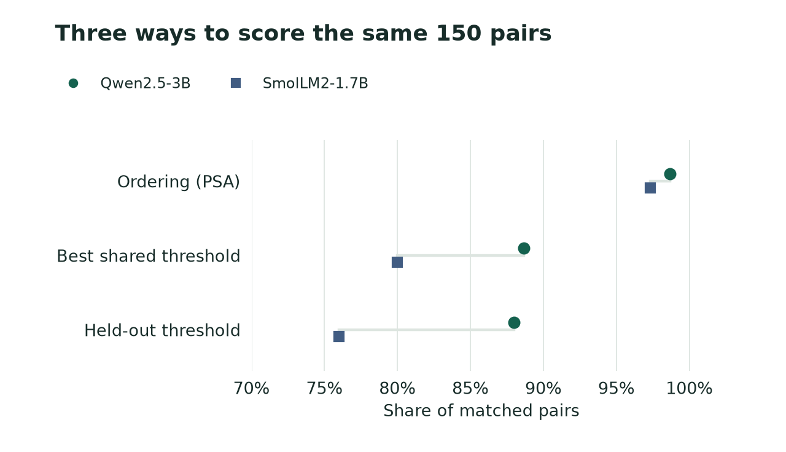

# PAIRSAFE

**Proxy-Resistant Paired Safety Evaluation for Refusal Boundaries**  
Wenzhang Du · AACL-IJCNLP 2026 · Long Paper · pp. 2720–2731

[Paper](https://aclanthology.org/2026.aacl-long.124/) · [Technical report](https://dqswordman.github.io/technical-reports/pairsafe/) · [中文技术报告](https://dqswordman.github.io/zh/technical-reports/pairsafe/) · [Hugging Face Space](https://huggingface.co/spaces/DQSWORDMAN/pairsafe) · [Frozen release](https://github.com/dqswordman/pairsafe/releases/tag/v1.0.0)

On **150 matched safe/unsafe pairs**, Qwen2.5-3B ranks 148 correctly, yet a threshold fitted on other pairs classifies both members correctly in 132. Its separate generation check succeeds on both members in 105 pairs. PAIRSAFE makes all three decisions visible.



## Main results

| Model | Mixed balanced accuracy | Paired ordering (PSA) | Oracle-PCDA | Held-out Cal-PCDA |
| --- | ---: | ---: | ---: | ---: |
| Qwen2.5-3B-Instruct | 0.940 | 0.987 | 0.887 | 0.880 (132/150) |
| SmolLM2-1.7B-Instruct | 0.900 | 0.973 | 0.800 | 0.760 (114/150) |

Both models use the paper’s two-refusal/two-answer contrastive margin. Oracle-PCDA chooses a threshold on the evaluated pairs. Cal-PCDA fits thresholds on training pairs with both twins kept in the same fold. The Qwen generation check uses archived refusal-rule labels.

## Reproduce on CPU

Extract the [versioned ZIP](https://github.com/dqswordman/pairsafe/releases/download/v1.0.0/pairsafe-v1.0.0.zip), enter its top-level directory, and run with Python 3.9 or later.

```sh
python scripts/verify.py --out replay.json
```

The standard-library command verifies both original checksum lists and reconstructs the headline table, fold ledger, exact-focus results, category-level results, four candidate-margin variants and Qwen generation outcomes. The [reproduction guide](docs/reproduction.md) maps each claim to its input and explains the final nested audit’s separate provenance.

## Explore the release

| Entry | Contents |
| --- | --- |
| [Interactive Space](https://huggingface.co/spaces/DQSWORDMAN/pairsafe) | Adjust the threshold and count how many pairs are simultaneously correct. |
| [English companion](docs/report.en.md) · [中文伴读](docs/report.zh.md) | Worked pair, figures, tables, controls and interpretation, readable offline. |
| [Derived records](data/) · [submitted software](software/) | Original sanitized pair indices, numeric score and generation records, manifests, aggregate tables and CPU utilities. |
| [Verified replay](reference/replay.json) | Recomputed metrics, five held-out folds per method and the worked pair at full precision. |
| [Provenance and rights](DATA_PROVENANCE.md) | Input digests, coverage of the replay and terms for derived data. |

## Citation

Wenzhang Du. 2026. *PAIRSAFE: Proxy-Resistant Paired Safety Evaluation for Refusal Boundaries*. AACL-IJCNLP, Volume 1, Long Papers, pp. 2720–2731. [ACL Anthology](https://aclanthology.org/2026.aacl-long.124/) · [BibTeX](docs/paper.bib) · [CITATION.cff](CITATION.cff)

The new software is MIT-licensed. The original supplement retains its [software license](software/LICENSE) and [derived-data terms](data/LICENSE).
